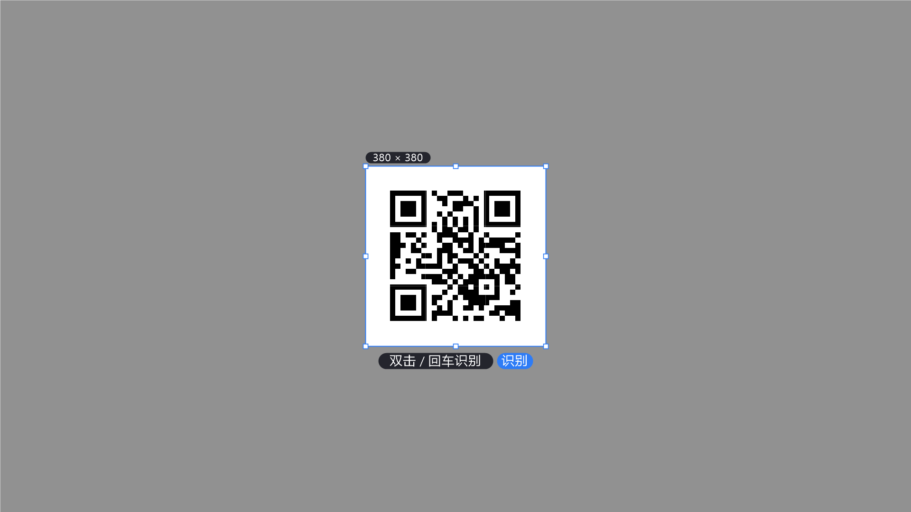

# QrSnap

> 一个即按即用的 Windows 桌面二维码截屏识别工具 —— 按 `Alt+Q` 唤起截屏框选，识别二维码内容并优雅地展示出来。

<p align="center">
  
</p>

## ✨ 功能特性

- **全局热键**：任意界面按 `Alt+Q` 立即进入截屏模式，无需切换窗口
- **类微信/QQ 的框选体验**：全屏遮罩、选区高亮、8 个缩放手柄、三分线辅助、实时尺寸提示
- **多种识别方式**：拖拽框选后双击、按回车，或点击「识别」按钮
- **智能内容解析**：自动区分网址 / Wi-Fi / 联系人(vCard) / 邮箱 / 电话 / 纯文本
- **结果卡片**：分类图标 + 内容展示，网址可一键「打开」，任何内容可一键「复制」
- **托盘常驻**：关闭窗口后驻留系统托盘，右键菜单可重新打开或退出
- **多显示器 / 高 DPI**：按物理像素工作，多屏拼接虚拟桌面完整支持
- **极致轻量**：C++ 版单文件仅 **约 280 KB**，零运行时依赖，启动 <100 ms

## 📦 两个版本

| 版本 | 技术栈 | 单文件体积 | 运行时依赖 | 状态 |
|------|--------|-----------|-----------|------|
| **QrSnapCpp**（推荐） | C++ / Win32 + GDI + GDI+ + quirc | **≈ 280 KB** | 无（静态链接 CRT） | ✅ 主版本 |
| QrSnap | C# / .NET 10 + Avalonia 11 | 29 MB（framework-dependent）<br>~100 MB（self-contained） | 需 .NET 10 运行时 | ✅ 功能对照版 |

## 🚀 快速开始

### 直接运行

下载或编译 `QrSnapCpp/QrSnap.exe`，双击运行：

1. 程序启动后显示介绍窗口，并在托盘区驻留图标
2. 按 `Alt+Q` 进入截屏模式
3. 拖拽框选二维码区域
4. 双击选区、按 `Enter`，或点击「识别」按钮
5. 结果窗口弹出，点「打开」跳转网址或点「复制」复制内容

> 按 `Esc` 或点鼠标右键可取消框选。

### 快捷键一览

| 操作 | 说明 |
|------|------|
| `Alt+Q` | 全局唤起截屏框选 |
| 拖拽 | 新建选区 |
| 选区内拖拽 | 整体移动选区 |
| 拖拽手柄 | 调整选区大小 |
| `Enter` / 双击 / 点击「识别」 | 识别选区内容 |
| `Esc` / 鼠标右键 | 取消 |

## 🔨 从源码构建

### C++ 版（QrSnapCpp）

**方式一：Visual Studio**

用 VS 打开 `QrSnap.sln`，选择 `Release | x64` 生成 `QrSnapCpp` 项目即可。

**方式二：命令行脚本**

```bat
cd QrSnapCpp
build.bat
```

`build.bat` 会直接调用 MSVC 编译链接，产物为 `QrSnapCpp\QrSnap.exe`（静态链接 CRT，单文件、无依赖）。

> 环境要求：Visual Studio 2022/2026 + "使用 C++ 的桌面开发" 工作负载 + Windows 10/11 SDK。

### .NET 版（QrSnap）

```bash
# 需要 .NET 10 SDK
dotnet build QrSnap/QrSnap.csproj -c Release

# 发布为单文件夹版本
dotnet publish QrSnap/QrSnap.csproj -c Release -r win-x64 --self-contained false -o publish
```

## 🗂 项目结构

```
QrSnap.sln                  # 解决方案（含 C# 版、C++ 版、测试与工具）
├── QrSnapCpp/              # 【主版本】C++ / Win32 实现
│   ├── src/
│   │   ├── app.cpp         # 入口、主窗口、托盘、全局热键、流程编排
│   │   ├── overlay.cpp     # 全屏框选覆盖层（双缓冲自绘）
│   │   ├── qrdecode.cpp    # quirc 解码封装 + 内容解析
│   │   ├── result.cpp      # 结果卡片窗口
│   │   ├── utils.cpp       # UTF-8、剪贴板、圆角绘制、文字折行
│   │   └── common.h        # 共享数据结构与声明
│   ├── quirc/              # vendored quirc 源码（纯 C，零依赖）
│   ├── assets/qrsnap.ico   # 应用图标
│   ├── app.rc              # 资源脚本（图标嵌入）
│   ├── QrSnapCpp.vcxproj   # VS 工程文件
│   └── build.bat           # 命令行构建脚本
├── QrSnap/                 # 【对照版本】C# / Avalonia 实现
│   ├── Services/           # 解码、内容解析、截屏、全局热键
│   ├── Views/              # 主窗口、框选覆盖层、结果窗
│   └── ViewModels/
├── QrSnap.Tests/           # 核心逻辑单元测试（21 项）
├── tools/
│   ├── ScreenShot/         # 端到端冒烟测试驱动
│   └── IconGen/            # 图标生成器
└── screenshots/            # 界面截图
```

## 🖼 界面预览

| 框选界面 | 识别结果 |
|---------|---------|
|  |  |

## 🔧 实现要点

- **截屏**：`GetDC(NULL)` + `BitBlt` 抓取整个虚拟桌面（`SM_XVIRTUALSCREEN` 等），`GetDIBits` 导出 BGRA 像素；覆盖层直接复用同一张 `HBITMAP` 作背景，视觉上「冻结屏幕」
- **框选渲染**：暗色遮罩 + 选区亮度还原 + 三分线 + 8 手柄，全部 GDI/GDI+ 自绘；采用**持久内存 DC 双缓冲**整帧输出，杜绝拖动时闪烁
- **解码**：`quirc` 轻量 C 库；BGRA 取 G 通道转灰度，失败时按 2× / 3× 最近邻放大重试，提升小尺寸码识别率
- **高 DPI**：`SetProcessDpiAwarenessContext(PER_MONITOR_AWARE_V2)`，全程物理像素，规避逻辑/物理像素换算错位
- **热键**：`RegisterHotKey` + 主线程消息循环（`WM_HOTKEY`），稳定无额外线程
- **托盘**：`Shell_NotifyIcon` + 自绘 `TrackPopupMenu` 右键菜单

## 📋 已知限制

- 仅支持 **Windows 10 / 11**（大量使用 Win32 API 与 DirectWM 圆角）
- 全局热键固定为 `Alt+Q`，若被其他程序占用会注册失败（主窗口会提示）
- 暂不支持动态二维码（如屏幕上的验证码动画）连续扫描
- 结果卡片不提供二维码历史记录

## 📄 许可

本项目为个人工具项目，可自由使用与修改。内置 [quirc](https://github.com/dlbeer/quirc) 库遵循其原始 ISC 许可。
